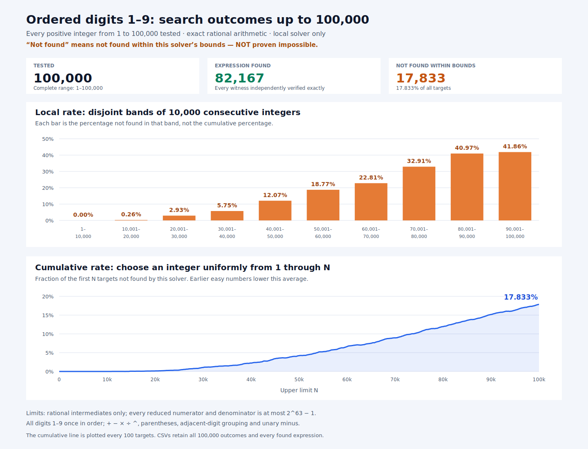

# 10958

A computational exploration of the **10,958 puzzle**: use the digits **1–9
exactly once, in increasing order**, to construct a target number.

This repository contains an exact rational solver, an exploratory real-power
solver, independent verification, and a saved scan of **every integer from 1
through 100,000**, with expressions, CSVs, an offline report, and charts.

**[Live report and charts →](https://q5m-ai.github.io/10958/)**

## [All 100,000 solutions — plain text](solutions.txt)

**[Read/download the complete list](https://raw.githubusercontent.com/q5m-ai/10958/main/solutions.txt)**:
one equation per line, `number = expression`, or `number = NOT FOUND`.
The succinct equation-list format uses `*` for multiplication, `/` for division,
and `^` for powers. Every formatted expression is independently verified exactly.
“NOT FOUND” means not found within the solver's bounds, not proven impossible.

**No exact expression for 10,958 was found. This is not an impossibility proof.**



## Results

The exact solver found **82,167** independently verified expressions and did not
find expressions for **17,833** targets within its bounds (**17.833%** overall).
Every returned expression was checked with a separate Python exact-fraction
evaluator, including the digit order and allowed syntax.

| Inclusive target range | Not found within bounds | Rate |
| --- | ---: | ---: |
| 1–10,000 | 0 | 0.00% |
| 10,001–20,000 | 26 | 0.26% |
| 20,001–30,000 | 293 | 2.93% |
| 30,001–40,000 | 575 | 5.75% |
| 40,001–50,000 | 1,207 | 12.07% |
| 50,001–60,000 | 1,877 | 18.77% |
| 60,001–70,000 | 2,281 | 22.81% |
| 70,001–80,000 | 3,291 | 32.91% |
| 80,001–90,000 | 4,097 | 40.97% |
| 90,001–100,000 | 4,186 | 41.86% |

These are **solver not-found rates**, not proven probabilities of impossibility.
A solution outside the searched class may still exist for any not-found target.
The bars measure separate 10,000-number bands; the line measures the cumulative
not-found fraction among 1 through N. All targets are tested, so these are not
sample estimates and no statistical confidence intervals are needed.

## Report and data

- **[Plain-text solutions for 1–100,000](solutions.txt)** — one equation per line.
- **[Live report on GitHub Pages](https://q5m-ai.github.io/10958/)**.
- [Offline HTML report](scan-100000/report.html) — download/clone and open locally.
- [PNG chart](scan-100000/plot.png) and [SVG chart](scan-100000/plot.svg).
- [All 100,000 results and found expressions](scan-100000/results.csv).
- [10,000-number bands](scan-100000/bands_10000.csv) and
  [1,000-number bands](scan-100000/bands_1000.csv).
- [All not-found targets](scan-100000/not_found.csv).
- [Raw mathematical solver output](scan-100000/raw.txt).
- [Metadata, bounds, timings and source/data hashes](scan-100000/metadata.json).
- [Original 0–11,111 regression output](fixtures/range-0-11111.txt).

All data was generated by the local solver, not retrieved from a web search or
external table. The repository does not claim that the individual expressions
are historically novel. Binaries, host logs, credentials, and session history
are not included. The report works offline; GitHub Pages also serves the public
report and downloads without requiring a local setup.

## Rules and limits

Allowed: `+ - * / ^`, parentheses, unary negation, and grouping **adjacent literal
digits**, such as `456`. The symbol `^` in solver output means exponentiation,
not Python's XOR. Fractional exponents may be made from the available digits.

Not allowed: factorials, inserted constants/digits, square-root operators,
rounding, rearranging digits, or joining calculated results into decimal strings.

### Exact solver (`exact.cpp`)

Dynamic programming stores nonnegative rational magnitudes and expression
backpointers for every contiguous digit interval through length seven. Unary
signs cover both signs; target-aware inverse lookups handle the final one or two
expression nodes without materializing length-eight/nine value sets.

- Reduced numerator and denominator magnitudes are bounded by **2^63 − 1**.
- Arithmetic is exact, using integer reduction and 128-bit products.
- Powers are retained only when integer-root tests establish a rational result.
  A helper tests roots with a floating-point estimate and exact integer checks;
  tests cross-check small intervals against an independent integer-only solver.
- The search retains **1,458,738** interval-value states.
- Larger rationals, irrational intermediates and complex intermediates are not
  exhaustively covered. Zero/unit target power lookups are not exhaustive either.
- Found witnesses are exact; not-found outcomes are bounded search results,
  **not mathematical certificates of impossibility or general completeness**.

The solver reproduces expressions for every integer from 0 through 11,111 except
10,958. The original puzzle collection is described in
[Taneja's paper](https://arxiv.org/abs/1302.1479). The endpoint 11,111 is a
collection boundary, not a mathematical ceiling.

### Numerical solver (`real.cpp`)

This exploratory search uses `long double`, allowing irrational fractional
powers. It retains about 4.8 million numerical states and uses inverse queries
for nearby values. Floating-point range, rounding, deduplication and nearest-hit
selection can lose candidates. **It is a discovery heuristic, not an exact proof.**

Its best result for 10,958 was the near-miss:

```text
1 + (2 - 3^(4*5/6/7))^(-8) + 9
= 10958.00205791026184020861639713004743219706268296...
```

That is **not a solution**. It is independently evaluated at 100-digit precision
by the verifier. This near-miss is also known publicly; no novelty is claimed.

A targeted leading-minus attempt gives:

```text
-1 + 2^(3^4/5)/(6+7/8) + 9
= 10957.97751172155435717160953949647454571523081715...
```

This also is not a solution.

## Build and use

Requirements: Python **3.10+**, Make, and a C++17 compiler supporting
`__uint128_t` (GCC or Clang on Linux). No Python packages or network access are
needed. PNG regeneration additionally uses an existing system `libcairo` through
`ctypes`; if absent, the analyzer still generates SVG, HTML and CSV files.

```sh
make
./exact 10957 10958 5479 25283
./exact --range 200 220
./exact --suffix 10959  # digits 2–9; tests -1 + suffix = 10958
./real 10958
./real --suffix 10959
```

Examples generated by the solver:

```text
10957 = 1 + (23 - 45) * (6 - 7 * 8 * 9)
 5479 = 1 + 2 * (3 + 456 * (7 + 8 - 9))
```

Run `./exact --range` without endpoints for the original 0–11,111 range.

## Reproduce the scan and plots

```sh
make scan     # rerun all 100,000 targets; replaces scan-100000/raw.txt on success
make report   # verify all witnesses; regenerate solutions.txt, report, CSVs, plots
make test
```

The saved scan took about 134 seconds on its original machine; timings vary.
`make scan` writes a temporary file first to preserve the previous complete scan
if interrupted. The analyzer requires ordered, unique results for all 100,000
targets and a completion footer. It verifies every found witness before writing
any report. Metadata hashes describe the current source files and input/output
data; they are provenance checks, not a formal proof of search completeness.

The report is self-contained and works offline. Its cumulative plot samples every
100 targets for readability; `results.csv` retains every target and cumulative
rate. Reproduction can change timestamps and timing metadata without changing
mathematical outcomes.

## GitHub Pages

The live report is hosted at **https://q5m-ai.github.io/10958/**.
On pushes to `main`, the Pages workflow runs `make test` before deploying an
explicit allowlist of report, chart and download files. `report.html` becomes
`index.html`; source code, binaries and host logs are not included in the site.
The plain-text list is also available at
https://q5m-ai.github.io/10958/solutions.txt.

## Tests

```sh
make test
```

The checks cover rational arithmetic, independent exhaustive comparison of all
30 digit intervals of length 1–4, the original 0–11,111 regression witnesses,
leading-minus search, exact evaluation of all 82,167 saved witnesses, malformed
or incomplete scan rejection, CSV consistency, file hashes, plot dimensions,
and offline report links. Tests use only local mathematical data.
